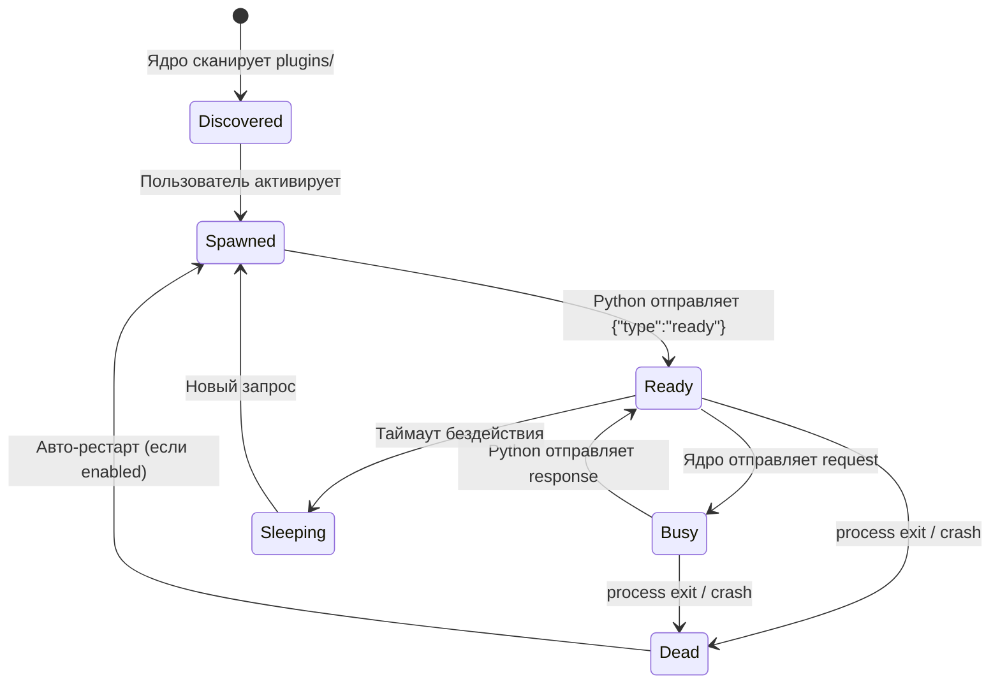

# Этап 1: Базовое Ядро «Omni»

Настройка проекта Tauri v2 + механизм запуска Python-плагинов как дочерних процессов с неблокирующим IPC.

## Структура каталогов

```
c:\c\Project\
├── src-tauri/                     # Rust-ядро (Командир)
│   ├── Cargo.toml
│   ├── tauri.conf.json
│   ├── capabilities/              # Tauri v2 permissions
│   │   └── default.json
│   └── src/
│       ├── main.rs                # Точка входа Tauri
│       ├── lib.rs                 # Регистрация команд и состояния
│       ├── plugin_manager.rs      # Реестр плагинов: discover → spawn → track
│       └── ipc.rs                 # Протокол общения Ядро ↔ Python (JSON-lines через stdin/stdout)
│
├── src/                           # Frontend (UI-оболочка)
│   ├── index.html
│   ├── main.js
│   └── styles.css
│
├── plugins/                       # Каталог плагинов (каждый — изолированный модуль)
│   └── hello_world/               # Пример плагина
│       ├── manifest.json          # Метаданные: имя, версия, entrypoint, permissions
│       └── main.py                # Точка входа Python-скрипта
│
└── shared/                        # Общие Python-утилиты (IPC-хелпер)
    └── omni_sdk/
        ├── __init__.py
        └── bridge.py              # Класс OmniBridge: чтение stdin → dispatch → stdout
```

---

## Ключевые архитектурные решения

### 1. Инструмент запуска процессов: `tokio::process::Command`

> [!IMPORTANT]
> Tauri v2 уже работает на tokio-рантайме. Используем `tokio::process::Command` — это **единственно правильный** выбор, потому что:

| Критерий | `std::process::Command` | `tokio::process::Command` |
|---|---|---|
| Блокировка UI-потока | **Да** — `wait()` замораживает поток | **Нет** — `.await` отдаёт управление |
| Асинхронный I/O (stdin/stdout) | Нет, нужен отдельный поток | Встроено через `AsyncRead`/`AsyncWrite` |
| Совместимость с Tauri | Надо вручную спавнить `std::thread` | Нативно в том же `tokio` runtime |
| Отмена / таймауты | Вручную через `kill()` + флаги | `tokio::select!` + `JoinHandle::abort()` |

**Влияние на RAM**: Каждый запущенный Python-процесс ≈ 15–30 МБ (голый интерпретатор). С библиотеками (numpy, torch) — значительно больше. Именно поэтому в архитектуре заложен режим "спящий/активный" — неиспользуемые плагины будут завершаться.

### 2. IPC-протокол: JSON-lines через stdin/stdout

> [!NOTE]
> На Этапе 1 используем простейший, но расширяемый протокол.

**Почему не gRPC/WebSocket/Named Pipes:**
- gRPC — лишняя зависимость + code-gen, overkill для Этапа 1
- WebSocket — нужен HTTP-сервер в каждом плагине, усложняет sandbox
- Named Pipes — платформозависимы, stdin/stdout — универсальны

**Формат сообщения (одна JSON-строка = одно сообщение):**

```json
{"id": "uuid", "type": "request", "method": "execute", "params": {"task": "greet", "name": "User"}}
```

```json
{"id": "uuid", "type": "response", "result": {"message": "Hello, User!"}}
```

```json
{"id": "uuid", "type": "error", "code": 1001, "message": "Unknown method"}
```

Протокол — однострочный JSON, разделённый `\n`. Это позволяет:
- Парсить построчно через `tokio::io::BufReader::read_line`
- Легко дебажить `tail -f`
- Расширять без breaking changes (новые поля игнорируются)

### 3. Жизненный цикл плагина



### 4. manifest.json — контракт плагина

```json
{
  "name": "hello_world",
  "version": "0.1.0",
  "description": "Demo plugin",
  "entrypoint": "main.py",
  "python": ">=3.10",
  "permissions": ["fs:read"],
  "auto_start": false,
  "idle_timeout_sec": 300
}
```

Ядро **никогда** не выполняет логику плагина — только читает манифест и управляет процессом.

---

## Proposed Changes

### Rust Core (`src-tauri/`)

#### [NEW] [Cargo.toml](file:///c:/c/Project/src-tauri/Cargo.toml)
- Зависимости: `tauri`, `serde`, `serde_json`, `tokio` (features: process, io-util, sync), `uuid`

#### [NEW] [main.rs](file:///c:/c/Project/src-tauri/src/main.rs)
- Точка входа: `tauri::Builder` с регистрацией команд и `PluginManager` как managed state

#### [NEW] [lib.rs](file:///c:/c/Project/src-tauri/src/lib.rs)
- Tauri `#[command]` функции:
  - `list_plugins()` → сканирует `plugins/`, возвращает список манифестов
  - `start_plugin(name)` → запускает Python-процесс
  - `stop_plugin(name)` → убивает процесс
  - `send_to_plugin(name, message)` → отправляет JSON в stdin плагина

#### [NEW] [plugin_manager.rs](file:///c:/c/Project/src-tauri/src/plugin_manager.rs)
- `PluginManager` — хранит `HashMap<String, PluginHandle>`
- `PluginHandle` — `tokio::process::Child` + `stdin writer` + `stdout reader task`
- Методы: `discover()`, `spawn()`, `kill()`, `send()`, `on_message()`

#### [NEW] [ipc.rs](file:///c:/c/Project/src-tauri/src/ipc.rs)
- Типы `IpcMessage`, `IpcRequest`, `IpcResponse`, `IpcError`
- Сериализация/десериализация через `serde`

---

### Frontend (`src/`)

#### [NEW] [index.html](file:///c:/c/Project/src/index.html)
- Минимальный UI: список плагинов, кнопки Start/Stop, лог сообщений

#### [NEW] [main.js](file:///c:/c/Project/src/main.js)
- Вызовы Tauri `invoke()` для управления плагинами

#### [NEW] [styles.css](file:///c:/c/Project/src/styles.css)
- Тёмная тема, минимальный дизайн

---

### Plugin Example (`plugins/hello_world/`)

#### [NEW] [manifest.json](file:///c:/c/Project/plugins/hello_world/manifest.json)
- Метаданные плагина

#### [NEW] [main.py](file:///c:/c/Project/plugins/hello_world/main.py)
- Простой цикл: ждёт JSON на stdin → обрабатывает → пишет JSON в stdout
- Использует `omni_sdk.bridge.OmniBridge`

---

### Python SDK (`shared/omni_sdk/`)

#### [NEW] [bridge.py](file:///c:/c/Project/shared/omni_sdk/bridge.py)
- `OmniBridge` — базовый класс:
  - `run()` — event loop (readline stdin → dispatch → write stdout)
  - `send_ready()` — сигнал готовности
  - `on_request(method, params)` — переопределяется плагином

---

## Open Questions

> [!IMPORTANT]
> **Python-интерпретатор**: Предполагаем, что `python` / `python3` доступен в PATH? Или планируем бандлить embedded Python с приложением? Это сильно влияет на UX «скачал-открыл».

> [!IMPORTANT]
> **Tauri v1 или v2?** Рекомендую **Tauri v2** — он стабилен, лучше API для permissions, и у нас нет legacy. Но если есть причины для v1 — скажи.

> [!NOTE]
> **Frontend-фреймворк**: На Этапе 1 предлагаю чистый HTML/JS без React/Vue. Фреймворк добавим на Этапе 2, когда UI станет сложнее. Согласен?

---

## Verification Plan

### Automated Tests
```bash
# 1. Проект компилируется
cd src-tauri && cargo build

# 2. Запуск приложения
cargo tauri dev

# 3. Тест IPC вручную: нажать "Start" на hello_world → в логе появится "Hello from plugin!"
```

### Manual Verification
- Запустить `cargo tauri dev`
- В UI нажать "Start" на плагине `hello_world`
- Увидеть в логе: `← ready` от плагина
- Отправить сообщение → увидеть ответ в логе
- Нажать "Stop" → процесс корректно завершён
- Убедиться, что UI не фризится при запуске/остановке
